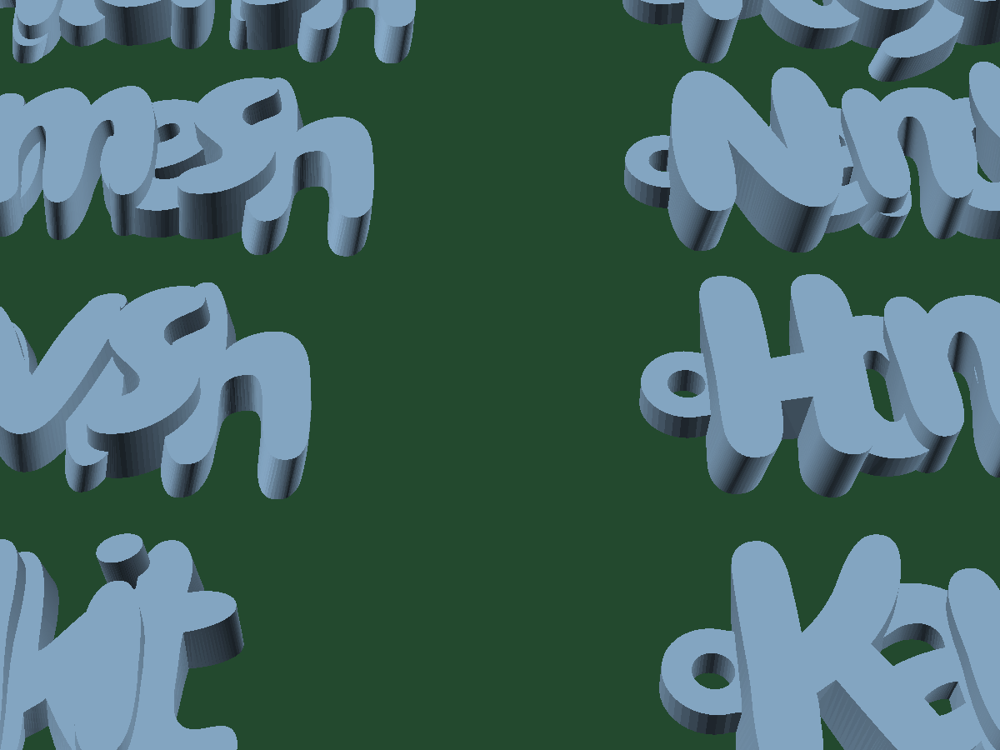
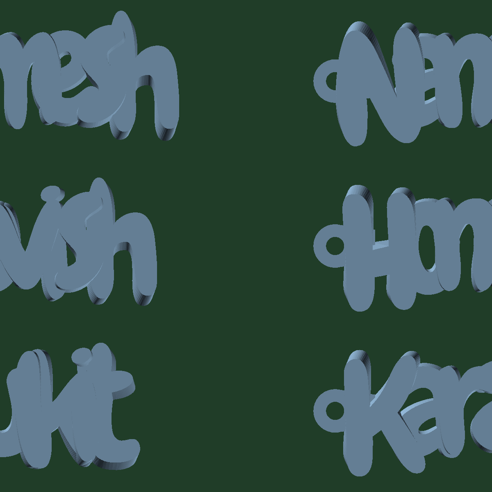
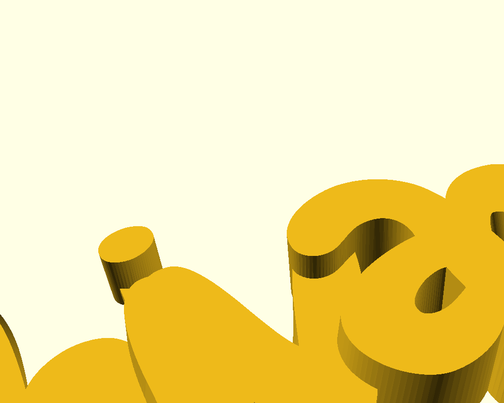
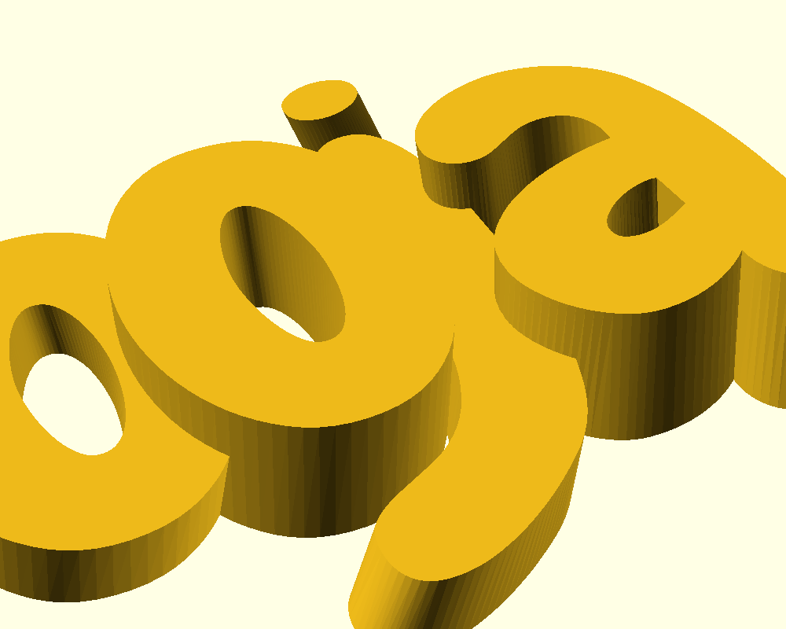

# 🏷️ Parametric 3D Printable Name Keyring Studio

[](LICENSE)
[](models/)
[](https://tumesh007.github.io/parametric-name-keyring/)
[](https://makerworld.com/en/models/3490868-parametric-custom-name-keyring)
[](models/All_10_Keyrings_A1_Mini.stl)

An advanced parametric 3D printable name keyring generator and complete production pipeline. Features alternating stepped 3D letter heights (+15-20% depth separation), 40% recessed under-bridges for floating dots on `i` & `j`, custom X/Y keylet positioning, smart automatic kerning, and a pre-arranged 10-keyring batch plate ready for the **Bambu Lab A1 Mini ($180 \times 180\,\text{mm}$)**.

🚀 **Try the Live Browser WebApp**: [https://tumesh007.github.io/parametric-name-keyring/](https://tumesh007.github.io/parametric-name-keyring/)

---

## 📸 Showcase Gallery

| Full 10-Keyring A1 Mini Plate (Isometric) | Top-Down Symmetrical Bed Layout (180x180mm) |
| :---: | :---: |
|  |  |

| Recessed 40% Under-Bridge ('i' in Shivansh) | Recessed 40% Under-Bridge ('j' in Pooja) |
| :---: | :---: |
|  |  |

---

## ⚙️ Key Engineering Upgrades

### 1. Standard 4.0 mm Keyring Eyelet + Custom X/Y Offset
- **Universal 4.0 mm Keyhole**: Precision $4.0\,\text{mm}$ circular bore ($2.0\,\text{mm}$ radius), universally compatible with standard split rings, jump rings, ball-chains, and carabiners.
- **High Tensile Strength**: $2.8\,\text{mm}$ solid perimeter walls ($9.6\,\text{mm}$ outer diameter) with an integrated tangent extension tab.
- **Customizable X and Y Placement**: Move the keylet horizontally (`Loop_x_offset`) closer or further away, or vertically (`Loop_y_offset`) up or down to align with whatever letter geometry you have (e.g. high on 'T', centered on 'S', low on 'L', etc.).

### 2. The Floating Dot Problem Solved (40% Recessed Under-Bridge)
In playful fonts like **Chewy**, lowercase `i` and `j` have disconnected round dots. Standard bridging approaches either print in mid-air (causing spaghetti failures) or add a full-height bar that deforms the circular silhouette into an ugly teardrop.

This project introduces a **proportional 40% recessed under-bridge**:
- **Aesthetic Top 60%**: Completely open gap. From the top and front reading angles, the dot appears 100% circular, detached, and authentic to the font design.
- **Structural Bottom 40%**: A solid base bridge spanning $Z \in [0, 0.40 \times h]$ ($\approx 1.4 - 2.4\,\text{mm}$ thick, 7 to 12 solid plastic layers) solidly anchors the dot to the stem and print bed.

### 3. High-Contrast Stepped 3D Letter Heights
Alternating heights create visual pop and tactile depth:
- **Capital 1st Letter**: $8.0\,\text{mm}$
- **Even Letters (2nd, 4th, 6th...)**: $3.6\,\text{mm}$
- **Odd Letters (3rd, 5th, 7th...)**: $6.0\,\text{mm}$
- **Keyring Eyelet**: $3.2\,\text{mm}$ height with standard **4.0 mm circular keyhole** and $2.8\,\text{mm}$ perimeter walls.
- **Helical Twist**: $-5.0^\circ$ continuous z-axis torsion.

### 4. Smart Typographic Width-Classification & Exact Overlap
Prevents narrow characters (`i`, `l`) from drifting apart while giving wide characters (`m`, `w`) sufficient breathing room:
```openscad
function char_w(c) = 
    (c == "m" || c == "w" || c == "M" || c == "W") ? 15.0 :
    (c == "i" || c == "l" || c == "I") ? 5.2 :
    (c == "j" || c == "t" || c == "f") ? 7.5 :
    (c >= "A" && c <= "Z") ? 14.0 :
    10.5;
```

### 5. Auto Letter Overlap + Manual Per-Letter Fine Tuning
- **Auto Overlap Arrangement**: In the WebApp and OpenSCAD, adjacent letters are automatically positioned based on their exact typographic bounding box edges:
  $$x_i = x_{i-1} + (bbox_{i-1}.x2 - bbox_i.x1) - \text{overlap\_mm}$$
  A master slider (`Auto_Overlap_mm = 1.8mm`) guarantees every letter touches with exact millimeter fusion, creating 100% watertight single-solid STLs.
- **Manual Per-Letter Controls**: Dynamic pair sliders (e.g. `S → h`, `h → i`, `i → v`) let you fine-tune the exact overlap of any individual letter combination with live 3D preview and a 'Reset All to Auto' button.

---

## 🖨️ Bambu Lab A1 Mini Batch Print Plate

A full 10-keyring batch is pre-sliced and pre-arranged on an exact $180 \times 180\,\text{mm}$ build plate:
- **Models Included**:
  1. `Shivansh`
  2. `Tumesh`
  3. `Pooja`
  4. `Rupali`
  5. `Pulkit`
  6. `Varun`
  7. `Honey`
  8. `Nancy`
  9. `Karan`
  10. `Luvish`
- **Footprint**: $146.10 \times 149.48\,\text{mm}$ centered on $180 \times 180\,\text{mm}$ (safe $15 - 17\,\text{mm}$ outer bed margins).
- **Scale**: $0.88\times$ uniform reduction ($22\,\text{mm}$ font size).
- **Plate File**: [`models/All_10_Keyrings_A1_Mini.stl`](models/All_10_Keyrings_A1_Mini.stl) (Single continuous manifold, $54,020$ triangles).

---

## 🌐 Live WebApp Architecture

The project includes a 100% self-contained single-page browser application built with Three.js and OpenType.js:
- **No Build Tools / Zero Node.js Requirement**: Runs directly in any modern web browser or GitHub Pages.
- **Real-Time 3D Viewport**: Orbit, pan, zoom, inspect stepped letter heights and 40% recessed under-bridges.
- **Instant Binary STL Export**: Generates and downloads clean binary STLs with correct triangle normals in $< 0.1\,\text{s}$.
- **Embedded Chewy Font**: Zero CORS issues; runs completely offline if saved locally.
- **URL**: [https://tumesh007.github.io/parametric-name-keyring/](https://tumesh007.github.io/parametric-name-keyring/)

---

## 🛠️ Recommended Slicer Settings

| Parameter | Bambu Studio / OrcaSlicer | PrusaSlicer |
| :--- | :--- | :--- |
| **Layer Height** | **0.16 mm** or **0.20 mm** | **0.16 mm** |
| **Wall Loops** | **3 to 4 walls** (1.2 - 1.6 mm) | **3 to 4 perimeters** |
| **Top / Bottom Shells** | 4 Top / 4 Bottom | 4 Top / 4 Bottom |
| **Infill** | 20% Gyroid or Cross Hatch | 20% Gyroid |
| **Supports** | **NONE** (100% support-free) | **NONE** |
| **Brim** | Not required on textured PEI | Optional |
| **Material** | PLA, PLA+, Silk PLA, or PETG | PLA / PETG |

---

## 📜 Project Links & License

- **MakerWorld Model**: [Parametric Custom Name Keyring #3490868](https://makerworld.com/en/models/3490868-parametric-custom-name-keyring)
- **GitHub Repository**: [tumesh007/parametric-name-keyring](https://github.com/tumesh007/parametric-name-keyring)
- **Live 3D Studio WebApp**: [https://tumesh007.github.io/parametric-name-keyring/](https://tumesh007.github.io/parametric-name-keyring/)
- **Author**: [tumesh007](https://github.com/tumesh007)
- **License**: Released under the [Creative Commons Attribution-NonCommercial-ShareAlike 4.0 International (CC BY-NC-SA 4.0)](LICENSE) license.
